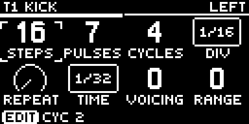

# Move E-1

E-1 is a 16-track Euclidean performance sequencer for [Ableton Move](https://www.ableton.com/move/). It runs as an overtake tool under [Schwung](https://github.com/charlesvestal/schwung) and plays Move's own tracks, a computer over USB-C, or both.

**Status: build 0.3.6.** E-1 has not yet been submitted to the Schwung catalog. Install it by hand as described below.


The control map is adapted from the [Move Bitwig](https://github.com/pi43r/move-bitwig) reference.

| | |
|---|---|
|  |  |
|  |  |

These screens are rendered from the real code with Schwung's own page renderer (`make preview`), so they match the display.

## Install (manual)

Download `e1-module.tar.gz` from [Releases](https://github.com/pi43r/move-e1/releases), or build it (below). Then:

```sh
scp e1-module.tar.gz ableton@move.local:/tmp/
ssh ableton@move.local 'cd /data/UserData/schwung/modules/tools && tar xzf /tmp/e1-module.tar.gz'
```

Restart Schwung. E-1 shows up under Tools.

The starter set has tracks 1 to 4 (kick, snare, hat, clap, notes 36 to 39) on MIDI channel 1. Put a drum rack on the Move track that listens to channel 1 and press Play. Tracks 5 to 16 start muted.

## The surface

| Control | What it does |
|---|---|
| Top 16 pads | Tracks 1 to 16. Tap to select. Hold one or more, and knobs, value pads and perform moves apply to the held tracks. |
| Step row | Shows the selected track's pulses. Tap a step to toggle it. Shift + step picks the step for its own values (see Single steps). Red steps carry their own values. |
| Left / Right | Page through steps 17 to 64. Shift + Left / Right rotates the pattern. |
| Bottom 16 pads | Follow the last knob you touched: divisions, a keyboard for Pitch, scales, styles, values. |
| Plus / Minus | Page the bottom pads, or move the Pitch keyboard an octave. |
| Knobs 1 to 8 | Edit the current page. Hold Shift for each knob's second function. The LEDs under knobs 1 to 4 and 5 to 8 have two colours, matching the two rows on screen. The knob you last touched is white and has corner marks on screen. Turning a knob with named values (Div, Scale, Style and so on) shows the whole list. |
| Jog wheel | Turn to change page: Left, Right. Click to go home. Shift + turn sets the tempo. |
| Left buttons | Pattern, Cycles, Random, Perform, top to bottom. Hold one to use it, press it twice to keep it up, press it once more to let it go. |
| Mute | Hold and tap track pads. The mutes apply together when you let go. Press Mute twice to keep it on: track pads then mute at once. Shift + track pad also mutes at once. |
| Sample | Temp. Hold it, play with the knobs and pads, let go and everything is back as it was. Press twice to keep Temp on, once more to undo. Capture keeps the changes. |
| Loop | Freeze. Hold it and the last 4 steps repeat. While it is on, tap a step to set how many steps repeat, and tap track pads to take tracks in or out. Hold track pads first to freeze only those. Press twice to keep it on, once more to stop. |
| Copy | Hold with two track pads, two pattern pads or two cycle pads to copy the first onto the second. |
| Delete | Hold with a track pad, pattern pad or cycle pad to clear it. Delete + touch a knob clears that knob's cycle edits and random amount. Delete + a red step clears its own values. Delete + any other step clears hand edits. |
| Capture | Save a pattern: press Capture, then tap one of the 16 slots on the bottom pads. Capture again or Back cancels. While Temp is on, Capture keeps the Temp changes. |
| Undo | Step back, up to 24 steps. |
| Play | Start and stop. When Move owns the clock, it presses Move's own Play. Shift + Play changes the clock source. |
| Menu | Open the menu. Shift + Menu changes the output: Move, Computer, Both. |
| Back | Step out: closes a menu level, Settings, cycle edit or a kept layer. Hold Back for half a second to switch to Move while E-1 keeps playing. To come back, use Schwung's Tools shortcut or open E-1 from the Tools menu. Shift + Back quits E-1 and stops it. |
| Record | Stays Move's. |

## Knob pages

There are two pages, Left and Right. Hold Shift for each knob's second function. Tempo is Shift + jog wheel.

Turn the jog wheel to change page. CC tracks add CC A and CC B after Left and Right.

```
Left     STEPS    PULSES   CYCLES   DIV          Right    VEL      SUSTAIN  PITCH    LENGTH
         REPEATS  TIME     VOICING  RANGE                 ACCENT   TIMING   SCALE    CHAN
```

**Left**

| Knob | Name | What it does | Shift |
|---|---|---|---|
| 1 | Steps | Length of the loop, 1 to 64 steps. | Fill: pulses added while the Fill move is held. |
| 2 | Pulses | Hits, spread as evenly as possible over the steps. | Rotate: moves every hit along by steps. |
| 3 | Cycles | How many cycles the track plays in turn, 1 to 16. Touch it to pick a cycle to edit. |  |
| 4 | Div | Length of one step: straight, triplet or dotted. |  |
| 5 | Repeats | Repeats after each pulse, 0 to 48, or INF until the next pulse. | Ramp: velocity change per repeat. |
| 6 | Time | Gap between repeats, as a division. | Pace: each gap grows or shrinks. |
| 7 | Voicing | Inverts the chord or adds octaves, as set by Style. | Style: PolyFix, PolyRamp, PolyClimb, MonoFix, MonoRamp, MonoClimb. |
| 8 | Range | How far Phrase moves the pitch, in scale steps. | Phrase: the shape of that movement. |

**Right** (note tracks)

| Knob | Name | What it does | Shift |
|---|---|---|---|
| 1 | Vel | Velocity, 1 to 127. | Prob: above zero drops single notes, below zero drops the whole pulse with its repeats. |
| 2 | Sustain | Note length. 50 is one full step. |  |
| 3 | Pitch | Moves the note pool in scale steps. Touch it to get the keyboard. | Harmony: moves pool notes in the scale, one note per click. |
| 4 | Length | Bars before the track starts over, or Off to run freely. | Quant: where a queued pattern starts, 1/4 to 8 bars. |
| 5 | Accent | How much the Groove shape changes velocity. | Groove: velocity shape over 16 steps. |
| 6 | Timing | Swing: moves every second step later or earlier. | Delay: moves the whole track by up to half a step. |
| 7 | Scale | Chrom, Major, Minor, Penta, Hira, Iwato, Tetra, Dorian. | Root: the scale's root note. |
| 8 | Chan | MIDI channel. | Output: Global, Move, Computer or Both. |

Poly styles play the whole pool as a chord. Mono styles play one pool note per pulse in turn. Climb walks through the inversions pulse by pulse.

**Right** (CC tracks)

| Knob | Name | What it does | Shift |
|---|---|---|---|
| 1 | Send | Pulse: send on each pulse. Change: only when the value changes. Glide: slide to the value. | Prob |
| 2 | Slew | Glide speed. |  |
| 4 | Length | As on note tracks. | Quant |
| 6 | Timing | Swing. | Delay |
| 8 | Chan | MIDI channel. | Output |

**CC A, CC B** (CC tracks): knobs 1 to 8 are CC lanes 1 to 8 and 9 to 16. A lane is Off until you turn it up. Shift + knob sets the lane's CC number.

**Settings** (Menu, then Settings)

| Knob | Name | What it does | Shift |
|---|---|---|---|
| 1 | Dest | Where tracks play: Move, Computer or Both. | Rnd: chance that random amounts apply. |
| 2 | Clock | Move, Internal or Computer. | Rate: how often random values change. |
| 3 | Tempo | Internal tempo, 20 to 300 BPM. | Grid: swing on single steps, pairs or fours. |
| 4 | ClkOut | Send MIDI clock to the computer when the clock is Internal. |  |
| 5 | Quant | Where a queued pattern starts. |  |
| 6 | Type | Note or CC track. | Mute |
| 7 | Repeat | Choke: a new pulse cuts the last one. Tail: they overlap. | Dir: Mono styles play up or down. |
| 8 | PhrRate | Phrase length: x1 is 4 bars, x2 is 2 bars, /2 is 8 bars. |  |

Knobs 6 to 8 on Settings, and the Shift functions of knobs 1 to 3, act on the selected or held tracks. Press Back, or click the jog wheel, to leave Settings.

## Lights

| Light | Means |
|---|---|
| Track pads | The selected track is bright orange (note track) or cyan (CC track). Other tracks that are on show the same colour, dim. Muted tracks are dark, or grey when selected. A track flashes white when it sounds. |
| Step row | Pulses in the track's colour, the playhead in white. |
| White | The current value, the playing cycle or pattern. |
| Orange | Amounts and the notes in the pool. |
| Grey | A choice you can make, not chosen now. Keys on the Pitch keyboard. |
| Blue | Triplets, black keys, scales, patterns with content. |
| Green | Bars for Length and Quant. Dark green: styles, grooves, phrases. A green track pad is the copy source. |
| Pink | Modifier pads at the right end of each row: octave, direction, phrase rate, swing grid, Choke or Tail. |
| Red | A cycle with its own edits. Track pads waiting to be muted. |

## Cycles

A cycle is one pass through a track's steps. A track plays its cycles in order, then starts again. Cycles 2 to 16 differ from cycle 1 only where you edited them.

The boxes at the bottom right of the screen are the selected track's cycles. The filled box is playing now. A half filled box has its own edits.

1. Turn Cycles (Left page, knob 3) to set how many cycles the track has.
2. Hold the Cycles button. The bottom pads show the cycles: white is playing, red has edits.
3. Tap a cycle pad. The track now loops that cycle and the screen says EDIT. Let go of the button.
4. Turn knobs, tap value pads or tap steps. Only that cycle changes.
5. Press Cycles once. The track plays all its cycles again.

Hold one cycle pad and tap others to edit several together. With Cycles held, Shift + pad sets the number of cycles, Copy + two pads copies a cycle, and Delete + pad clears a cycle's edits. The Cycles button blinks red while you are editing a cycle.

Length, Cycles, Delay, Grid, Chan, Output, the random chance and rate, and the Settings knobs always change the whole track.

## Single steps

Any step can have its own values, for example more repeats on one hit to ratchet it.

1. Hold Shift and tap a step. The step is added if it was empty, lights white, and the screen says EDIT.
2. Keep Shift held and tap more steps to edit them together.
3. Turn knobs or tap value pads. Only the picked steps change: velocity, chance, sustain, repeats, time, ramp, pace, pitch, harmony, voicing, style, range, phrase, scale, root, accent and groove.
4. Press Back to edit the whole track again.

Steps with their own values are red on the step row. Delete + a red step clears them. A track holds up to 16 such steps.

## Random

Hold Random and turn a knob to set how far that knob's value wanders. Hold Random and turn the jog wheel to set the chance, with Shift the rate. Delete + Random clears the track's random amounts.

## Perform

Hold Perform, or press it twice to keep it up, and the bottom pads become 16 moves. Hold a pad to engage it. Shift + pad latches it, and tapping a latched pad lets it go. Held track pads limit a move to those tracks. Shift + Perform releases every move.

| Row | Pads, left to right |
|---|---|
| Upper | Fill · Ratchet 2 · Ratchet 3 · Ratchet 4 · Half time · Double time · Reverse · Accent |
| Lower | Freeze 1 · Freeze 2 · Freeze 4 · Freeze 8 · Solo · Restart · Rotate +1 · New dice |

Restart, Rotate +1 and New dice act once per tap. Rotate +1 changes the saved track, and Undo takes it back. New dice picks a new random seed.

## Sets and patterns

A pattern is a copy of all 16 tracks. A set holds 16 patterns.

To save a pattern, press Capture and tap a slot. To play one, hold Pattern and tap its pad. It starts on the next quantize line. Tap it again to switch at once. Copy + two pads copies a pattern, Delete + pad clears one.

Menu has five rows: Save, Save as, Load, Rename and Settings. Turn the jog wheel, click to choose, Back to step up. Rename offers the selected track, the playing pattern and the set. In the Load list, hold Delete and click to delete a set.

A set changes on disk only when you save it. The live state is saved separately and comes back the next time E-1 starts. Everything is stored in `/data/UserData/schwung/e1/`.

## Connecting

**Move.** With Dest set to Move, notes go into Move by channel, as if from a USB keyboard. Channels 1 to 4 reach Move's tracks. Clock set to Move follows Move's transport.

**Computer.** With Dest set to Computer, notes go out over USB-C to the *Ableton Move (Standalone Port)* MIDI input. Set each instrument on the computer to the channel of the E-1 track that should play it. Choosing Computer sets the clock to Internal, and Shift + jog sets the tempo. With ClkOut on, E-1 sends MIDI clock to the computer.

**Clock Computer** means Move syncs to the computer's clock and E-1 follows Move. Turn on MIDI clock sync in Move's settings. E-1 shows a warning until you do.

**Both** sends to Move and the computer. Each track's Output can override Dest.

## Build and test

```sh
make test                       # engine and DSP against a fake host (gcc, ASan, UBSan), library under node
bash scripts/build.sh           # ARM64 build into dist/; uses aarch64-linux-gnu-gcc or Docker
make preview SCHWUNG=../schwung # render docs/screens with Schwung's page renderer
```

Pushing a `v*` tag builds the module, attaches it to a GitHub release and updates `release.json`.

```
src/engine/   sequencing engine, plain C, no host calls
src/e1/       overtake tool: dsp/e1_plugin.c, ui.js, e1_view.mjs, e1_library.mjs
src/include/  Schwung API headers (vendored)
tests/        host-side tests
tools/        headless screen preview
docs/         control map and rendered screens
```

## Credits and licence

Inspired by the Torso T-1. Not affiliated with Torso Electronics. Runs on [Schwung](https://github.com/charlesvestal/schwung). The control map is adapted from the Move Bitwig reference.

MIT. See [LICENSE](LICENSE).
