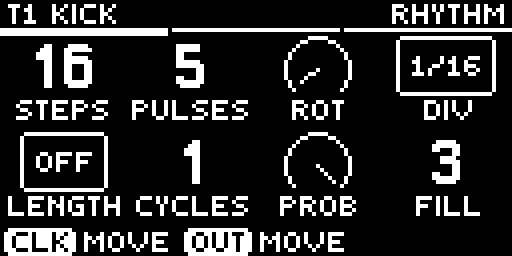
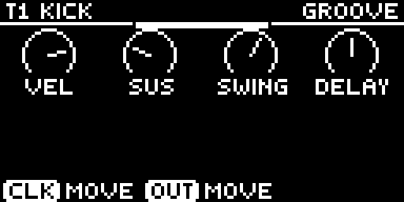
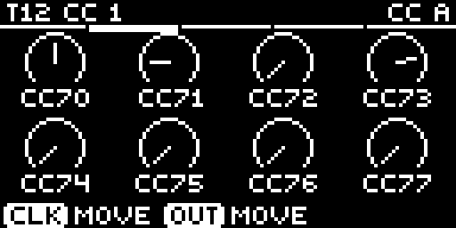
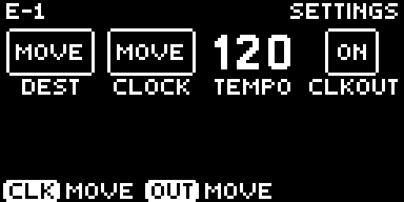
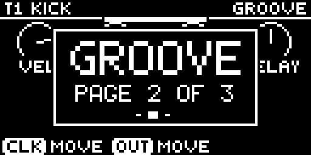
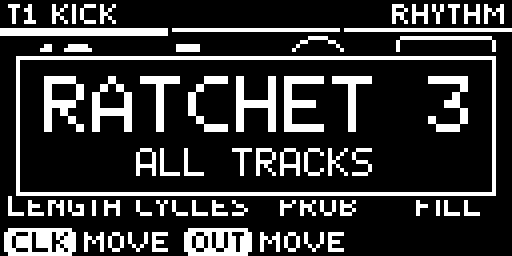

# Move E-1

A 16-track Euclidean sequencer for [Ableton Move](https://www.ableton.com/move/), running under [Schwung](https://github.com/charlesvestal/schwung). It plays into Move's own instruments and Schwung slots, or out over USB-C to a computer (Bitwig, Live or any DAW), or both.

The idea and most of the vocabulary come from the [Torso T-1](https://torsoelectronics.com/pages/t-1). E-1 is an independent project and is not affiliated with or endorsed by Torso Electronics. The controls are laid out for Move, not copied from the T-1.

**Status: build 0.2.** Notes reach Move's instruments; the computer route is still untested. Anything marked *planned* is not in this build.


The control map is adapted from the [Move Bitwig](https://github.com/pi43r/move-bitwig) reference.

## Two modules

| Module | ID | Schwung type | What it is |
|---|---|---|---|
| E-1 | `e1` | overtake tool | All 16 tracks, the pads, the step row and its own screens |
| E-1 Lite | `e1_lite` | MIDI FX | Parked. It will be redone as a Schwung-only performance effect. |

Work is on the E-1 tool for now. The Lite code stays in the repo but isn't in the release notes or the catalog.

## What 0.2 does

- 16 tracks, each with Steps (1–64), Pulses, Rotate, Division (straight, triplet, dotted), Length in bars or free-running, Probability, Fill, Velocity, Sustain, Swing and Delay.
- Steps added or removed by hand on the step row. Removed hits come back when you change Pulses, as on the T-1.
- Note tracks and CC tracks. A CC track has 16 lanes, each with its own CC number, sent on each pulse, on change, or as a glide with slew.
- Destination: Move, Computer or Both, with a per-track override.
- Clock: Follow Move, Internal (own tempo, sends MIDI clock to the computer) or Follow computer (Move syncs to the computer, E-1 follows Move).
- Knob pages drawn with Schwung's movy-style renderer. The jog wheel changes page and a large label names it. Small ranges take several detents per value.
- Four views on the bottom pads: Values (direct choices for the last knob), Perform (16 hold or latch moves: fill, ratchet, half and double time, reverse, thin, freeze, accent, solo, restart, rotate, new dice), Mutes (tap mutes, Shift solos) and Patterns (16 slots, recalled on the next bar).
- Hold track pads to aim knobs, +/- and perform moves at just those tracks.
- Temp on the Sample button, Capture to save a pattern, copy and clear tracks, and Undo.
- Autosave to `/data/UserData/schwung/e1/`.

Planned: pitch (scales, note pools, voicing), cycles, random modulation, banks of patterns.

## Screens

| | |
|---|---|
|  |  |
|  |  |
|  |  |

These are rendered headlessly with Schwung's own page renderer (`make preview SCHWUNG=../schwung`), so they match what the display draws.

## Install (manual, until it is in the Schwung catalog)

Download `e1-module.tar.gz` from [Releases](https://github.com/pi43r/move-e1/releases), or build it (below). Then:

```sh
scp e1-module.tar.gz ableton@move.local:/tmp/
ssh ableton@move.local 'cd /data/UserData/schwung/modules/tools && tar xzf /tmp/e1-module.tar.gz'
```

Restart Schwung. E-1 shows up under Tools.

The starter set sends tracks 1–4 (kick, snare, hat, clap, notes 36–39) on MIDI channel 1. Put a drum rack on the Move track that listens to channel 1 and press Play. Tracks 5–16 start muted.

## Using it with a computer

Press Menu, set Destination to Computer (or press Shift + Menu). The clock switches to Internal, and Shift + jog sets the tempo. On the computer, enable the *Ableton Move (Standalone Port)* MIDI input and set each instrument track to the channel of the E-1 track that should play it. No controller script is needed. This route hasn't been tested on hardware yet.

## Build

```sh
make test              # engine, tool DSP and Lite against a fake host (gcc, ASan, UBSan)
bash scripts/build.sh  # ARM64 build into dist/; uses aarch64-linux-gnu-gcc or Docker
```

Pushing a `v*` tag builds both modules, attaches them to a GitHub release and updates `release.json`.

## Layout

```
src/engine/   sequencing engine, plain C, no host calls
src/e1/       overtake tool: dsp/e1_plugin.c, ui.js, e1_view.mjs
src/e1_lite/  MIDI FX, parked
src/include/  Schwung API headers (vendored)
tests/        host-side tests
tools/        headless screen preview
docs/         control map and rendered screens
```

## Licence

MIT. See [LICENSE](LICENSE).
