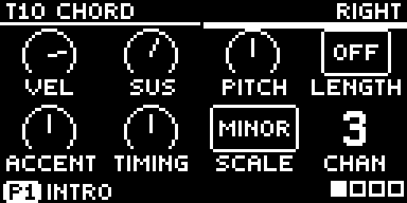
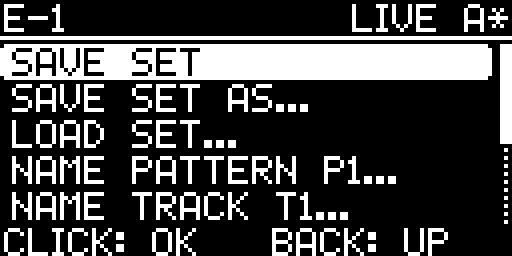

# Move E-1

E-1 is a 16-track Euclidean sequencer for [Ableton Move](https://www.ableton.com/move/). It runs under [Schwung](https://github.com/charlesvestal/schwung) and plays Move's own tracks, a computer over USB-C, or both.

**[Read the guide](https://pi43r.github.io/move-e1/)** for install steps and how to play it. The guide's source is [docs/index.html](docs/index.html).


| | |
|---|---|
|  |  |
|  |  |

Build 0.4.1. Open work and hardware tests are in [TO-DO.md](TO-DO.md).

## Install

Download `e1-module.tar.gz` from [Releases](https://github.com/pi43r/move-e1/releases), or build it (below). Then:

```sh
scp e1-module.tar.gz ableton@move.local:/tmp/
ssh ableton@move.local 'cd /data/UserData/schwung/modules/tools && tar xzf /tmp/e1-module.tar.gz'
```

Restart Schwung. E-1 is under Tools.

## Build and test

```sh
make test                       # engine and DSP against a fake host (gcc, ASan, UBSan), library under node
bash scripts/build.sh           # ARM64 build into dist/; uses aarch64-linux-gnu-gcc or Docker
make preview SCHWUNG=../schwung # render docs/screens with Schwung's page renderer
```

Pushing a `v*` tag builds the module, attaches it to a GitHub release and updates `release.json`.

```
src/engine/   sequencing engine, plain C, no host calls
src/e1/       overtake tool: dsp/e1_plugin.c, ui.js, e1_view.mjs, e1_library.mjs
src/include/  Schwung API headers (vendored)
tests/        host-side tests
tools/        headless screen preview
docs/         guide (GitHub Pages), control map, rendered screens
```

## Credits and licence

Inspired by the Torso T-1. Runs on [Schwung](https://github.com/charlesvestal/schwung).

MIT. See [LICENSE](LICENSE).
