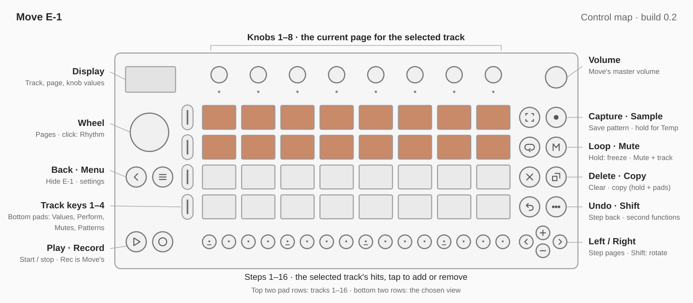
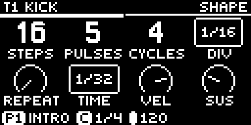
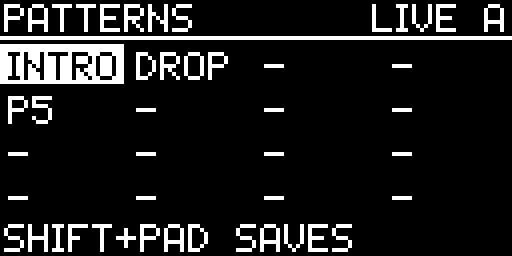

# Move E-1

E-1 is a 16-track Euclidean performance sequencer for [Ableton Move](https://www.ableton.com/move/). It runs as an overtake tool under [Schwung](https://github.com/charlesvestal/schwung) and plays Move's own tracks, a computer over USB-C, or both.

The idea and most of the vocabulary come from the [Torso T-1](https://torsoelectronics.com/pages/t-1). E-1 is an independent project and is not affiliated with or endorsed by Torso Electronics.

**Status: build 0.3.0.** Build 0.3 replaces the 0.2 control surface. E-1 has not yet been submitted to the Schwung catalog. Install it by hand as described below.



The control map is adapted from the [Move Bitwig](https://github.com/pi43r/move-bitwig) reference.

| | |
|---|---|
|  |  |
|  |  |

These screens are rendered from the real code with Schwung's own page renderer (`make preview`), so they match the display.

## Install (manual)

Download `e1-module.tar.gz` from [Releases](https://github.com/pi43r/move-e1/releases), or build it (below). Then:

```sh
scp e1-module.tar.gz ableton@move.local:/tmp/
ssh ableton@move.local 'cd /data/UserData/schwung/modules/tools && tar xzf /tmp/e1-module.tar.gz'
```

Restart Schwung. E-1 shows up under Tools.

The starter set has tracks 1 to 4 (kick, snare, hat, clap, notes 36 to 39) on MIDI channel 1. Put a drum rack on the Move track that listens to channel 1 and press Play. Tracks 5 to 16 start muted.

## The surface

| Control | What it does |
|---|---|
| Top 16 pads | Tracks 1 to 16. Tap to select. Hold one or more, and knobs, value pads and perform moves apply to the held tracks. |
| Step row | Shows the selected track's pulses for the cycle on screen. Tap a step to toggle it by hand. Shift + step sets Steps. |
| Left / Right | Page through steps 17 to 64. Shift + Left / Right rotates the pattern. |
| Bottom 16 pads | Follow the last knob you touched: divisions, a keyboard for Pitch, scales, styles, values. |
| Plus / Minus | Page the bottom pads, or move the Pitch keyboard an octave. |
| Knobs 1 to 8 | Edit the current page. Hold Shift for each knob's second function. |
| Jog wheel | Turn to change page. Click to go home. Shift + turn sets the tempo. |
| Left buttons | Pattern, Cycles, Temp, Perform, top to bottom. Hold for momentary, tap to latch. Temp works only while held. |
| Mute | Hold and tap track pads. The mutes apply together when you let go. Shift + track pad mutes at once. |
| Sample | Hold and turn a knob to set how far that knob's value wanders at random. Delete + Sample clears random amounts. |
| Loop | Hold to freeze the last 4 steps. Tap a step while holding to set the freeze length. |
| Copy | Hold with two track pads, two pattern pads or two cycle pads to copy the first onto the second. |
| Delete | Hold with a track pad, pattern pad or cycle pad to clear it. Delete + touch a knob clears that knob's cycle edits and random amount. Delete + step clears hand edits. |
| Capture | Save the current state to the next empty pattern. While Temp is held, keep the Temp edits. |
| Undo | Step back, up to 24 steps. |
| Play | Start and stop. When Move owns the clock, it presses Move's own Play. Shift + Play changes the clock source. |
| Menu | Open the menu. Shift + Menu changes the output: Move, Computer, Both. |
| Back | Hide E-1. It keeps playing. |
| Record | Stays Move's. |

## Knob pages

Note tracks have Shape and Tone. CC tracks have Shape, CC A, CC B and Motion. The header names the page. Knobs with few values need several detents per value.

**Shape** (all tracks)

| Knob | Name | What it does | Shift |
|---|---|---|---|
| 1 | Steps | Length of the loop, 1 to 64 steps | Length: bars before the track starts over, or Off |
| 2 | Pulses | Hits spread as evenly as possible over the steps | Rotate: moves every hit along by steps |
| 3 | Cycles | How many cycles the track plays in turn, 1 to 16 | Fill: pulses added while the Fill move is held |
| 4 | Div | Length of one step: straight, triplet or dotted | Quant: where a queued pattern starts (1/4 to 8 bars) |
| 5 | Repeats | Repeats after each pulse, 0 to 48 or INF | Ramp: velocity change per repeat |
| 6 | Time | Gap between repeats | Pace: gaps grow or shrink with each repeat |
| 7 | Vel | Velocity, 1 to 127 | Prob: chance a pulse is dropped (see below) |
| 8 | Sustain | Note length. 50 is one full step | Delay: moves the whole track by up to half a step |

Prob above zero drops single notes. Below zero it drops the whole pulse with its repeats.

**Tone** (note tracks)

| Knob | Name | What it does | Shift |
|---|---|---|---|
| 1 | Pitch | Moves the note pool up or down in scale steps. Touch it to get the keyboard. | Harmony: moves pool notes in the scale, one note per click |
| 2 | Voicing | Inverts the chord or adds octaves, as set by Style | Style: PolyFix, PolyRamp, PolyClimb, MonoFix, MonoRamp, MonoClimb |
| 3 | Range | How far Phrase moves the pitch, in scale steps | Phrase: the shape of that movement (Cad1 to 4, Saw, Tri, Sine, Pulse) |
| 4 | Scale | Chrom, Major, Minor, Penta, Hira, Iwato, Tetra, Dorian | Root: the scale's root note |
| 5 | Accent | How much the Groove shape changes velocity | Groove: velocity shape over 16 steps |
| 6 | Timing | Swing: moves every second step later or earlier | Grid: swing on single steps, pairs or fours |
| 7 | Rnd | Chance that random amounts apply, 0 to 100 | Rate: how often random values change |
| 8 | Chan | MIDI channel | Output: Global, Move, Computer or Both |

Poly styles play the whole pool as a chord. Mono styles play one pool note per pulse in turn. Climb walks through the inversions pulse by pulse.

**CC A, CC B** (CC tracks): knobs 1 to 8 are CC lanes 1 to 8 and 9 to 16. A lane is Off until you turn it up. Shift + knob sets the lane's CC number.

**Motion** (CC tracks)

| Knob | Name | What it does | Shift |
|---|---|---|---|
| 1 | Send | Pulse: send on each pulse. Change: only when the value changes. Glide: slide to the value. | |
| 2 | Slew | Glide speed | |
| 6 | Timing | Swing, as on Tone | Grid |
| 7 | Rnd | Chance that random amounts apply | Rate |
| 8 | Chan | MIDI channel | Output |

**Settings** (Menu, then Settings)

| Knob | Name | What it does | Shift |
|---|---|---|---|
| 1 | Dest | Where tracks play: Move, Computer or Both | |
| 2 | Clock | Move, Internal or Computer | |
| 3 | Tempo | Internal tempo, 20 to 300 BPM | |
| 4 | ClkOut | Send MIDI clock to the computer when the clock is Internal | |
| 5 | Quant | Where a queued pattern starts | |
| 6 | Type | Note or CC track | Mute |
| 7 | Repeat | Choke: a new pulse cuts the last one. Tail: they overlap. | Dir: Mono styles play up or down |
| 8 | PhrRate | Phrase length: x1 is 4 bars, x2 is 2 bars, /2 is 8 bars | |

Knobs 6 to 8 on Settings act on the selected or held tracks. Press Menu again, or click the jog wheel, to leave Settings.

## Cycles

A cycle is one pass through a track's steps. A track plays its cycles in order, then starts again. Cycles 2 to 16 differ from cycle 1 only where you edited them.

Hold or latch Cycles and the bottom pads show cycles 1 to 16. Tap a cycle to edit only that cycle: knob turns, value pads and step taps then change that cycle, and the track loops it so you hear the change. Tap it again to go back to editing all cycles. Hold one cycle pad and tap others to edit several together. Shift + pad sets the number of cycles. Copy + two pads copies a cycle. Delete + pad clears a cycle's edits.

Length, Cycles, Delay, Grid, Rnd, Rate, Chan, Output and the Settings knobs always change the whole track.

## Perform

Hold or latch Perform and the bottom pads become 16 moves. Hold a pad to engage it. Shift + pad latches it, and tapping a latched pad lets it go. Held track pads limit a move to those tracks. Shift + Perform releases every move.

| Row | Pads, left to right |
|---|---|
| Upper | Fill · Ratchet 2 · Ratchet 3 · Ratchet 4 · Half time · Double time · Reverse · Accent |
| Lower | Freeze 1 · Freeze 2 · Freeze 4 · Freeze 8 · Solo · Restart · Rotate +1 · New dice |

Restart, Rotate +1 and New dice act once per tap. Rotate +1 changes the saved track, and Undo takes it back. New dice picks a new random seed.

## Sets and patterns

A pattern is a copy of all 16 tracks. A set holds 16 patterns. Hold or latch Pattern: tap a pad to play that pattern on the next quantize line, tap it again to switch at once, Shift + pad to save into it. Copy and Delete work on pattern pads. Capture saves to the next empty slot.

Menu holds Settings, Sets (save, save as, new, load, rename, duplicate, delete), Patterns (play, save, rename, copy, clear), Track presets (save the selected track, load, rename, delete) and Tracks (rename). Names are typed with Schwung's on-screen keyboard.

A set changes on disk only when you save it. The live state is saved separately and comes back the next time E-1 starts. Everything is stored in `/data/UserData/schwung/e1/`.

## Connecting

**Move.** With Dest set to Move, notes go into Move by channel, as if from a USB keyboard. Channels 1 to 4 reach Move's tracks. Clock set to Move follows Move's transport.

**Computer.** With Dest set to Computer, notes go out over USB-C to the *Ableton Move (Standalone Port)* MIDI input. Set each instrument on the computer to the channel of the E-1 track that should play it. Choosing Computer sets the clock to Internal, and Shift + jog sets the tempo. With ClkOut on, E-1 sends MIDI clock to the computer.

**Clock Computer** means Move syncs to the computer's clock and E-1 follows Move. Turn on MIDI clock sync in Move's settings. E-1 shows a warning until you do.

**Both** sends to Move and the computer. Each track's Output can override Dest.

## Build and test

```sh
make test                       # engine and DSP against a fake host (gcc, ASan, UBSan), library under node
bash scripts/build.sh           # ARM64 build into dist/; uses aarch64-linux-gnu-gcc or Docker
make preview SCHWUNG=../schwung # render docs/screens with Schwung's page renderer
```

Pushing a `v*` tag builds the module, attaches it to a GitHub release and updates `release.json`.

```
src/engine/   sequencing engine, plain C, no host calls
src/e1/       overtake tool: dsp/e1_plugin.c, ui.js, e1_view.mjs, e1_library.mjs
src/include/  Schwung API headers (vendored)
tests/        host-side tests
tools/        headless screen preview
docs/         control map and rendered screens
```

## Credits and licence

Inspired by the Torso T-1. Not affiliated with Torso Electronics. Runs on [Schwung](https://github.com/charlesvestal/schwung). The control map is adapted from the Move Bitwig reference.

MIT. See [LICENSE](LICENSE).
